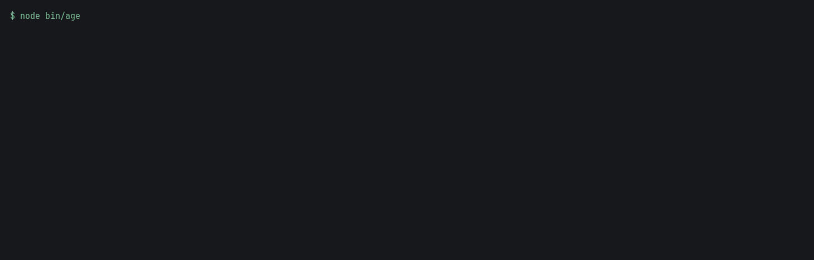

# agent-context-tax

Count the tokens Claude Code, Codex, and Cursor load before you type a message.

A session can open with tens of thousands of tokens already spent on instruction files, rules, skill listings, and MCP server names. Those files live in the repo and in your home directory, and none of the three tools prints a per-file bill.

## Quickstart

```bash
npx github:kamilkaczmareksolutions/agent-context-tax
```

From a clone of this repo:

```bash
npm install
npx .
```

Add `--json` to print the same report as JSON.

The example below, and the GIF, use the fixture checked into this repo. It is sample data, not a scan of a real home directory.

```bash
node bin/agent-context-tax.js \
  --cwd test/fixtures/project \
  --home test/fixtures/home \
  --walk-root test/fixtures/project \
  --codex-home test/fixtures/home/.codex
```

## Example

```
file                                    tool      tokens    percent    load
CLAUDE.md                               claude    7         12.1       startup
~/.claude/CLAUDE.md                     claude    6         10.3       startup
.claude/rules/global-rule.md            claude    13        22.4       startup
.claude/skills/auto-skill/SKILL.md      claude    8         13.8       startup
.claude/skills/manual-skill/SKILL.md    claude    7         12.1       startup
~/.claude/skills/home-skill/SKILL.md    claude    10        17.2       startup
.mcp.json#fixture-docs                  claude    3         5.2        startup estimate
~/.claude.json#user-global              claude    2         3.4        startup estimate
~/.claude.json#project-user             claude    2         3.4        startup estimate
claude measured 58
~/.codex/config.toml#user_codex         codex     3         8.3        startup estimate
.codex/config.toml#codex_srv            codex     3         8.3        startup estimate
~/.codex/AGENTS.md                      codex     9         25         startup
AGENTS.md                               codex     12        33.3       startup
.agents/skills/live-skill/SKILL.md      codex     9         25         startup
codex measured 36
AGENTS.md                               cursor    12        12.6       startup
CLAUDE.md                               cursor    7         7.4        startup
.cursorrules                            cursor    6         6.3        startup
.cursor/rules/always-apply.mdc          cursor    6         6.3        startup
.cursor/rules/requestable.mdc           cursor    5         5.3        startup
~/.cursor/rules/home-always.mdc         cursor    5         5.3        startup
.agents/skills/disabled-skill/SKILL.md  cursor    7         7.4        startup
.agents/skills/live-skill/SKILL.md      cursor    9         9.5        startup
.cursor/skills/demo/SKILL.md            cursor    7         7.4        startup
.claude/skills/auto-skill/SKILL.md      cursor    8         8.4        startup
.claude/skills/manual-skill/SKILL.md    cursor    7         7.4        startup
~/.claude/skills/home-skill/SKILL.md    cursor    10        10.5       startup
.cursor/mcp.json#cursor-fixture         cursor    3         3.2        startup estimate
~/.cursor/mcp.json#home-cursor          cursor    3         3.2        startup estimate
cursor measured 95
estimate: tool schemas not fetched; Claude tool search defers schemas by default (https://code.claude.com/docs/en/mcp). Count is the server name only.
estimate: tool schemas not fetched. Count is the server name only.
lower bound from enabled_tools; schemas not fetched

What to trim
  13 tokens  .claude/rules/global-rule.md (claude)
  12 tokens  AGENTS.md (codex)
  12 tokens  AGENTS.md (cursor)
  10 tokens  ~/.claude/skills/home-skill/SKILL.md (claude)
  10 tokens  ~/.claude/skills/home-skill/SKILL.md (cursor)
  overlap 0%  AGENTS.md vs CLAUDE.md
  dead legacy-cursorrules  .cursorrules (cursor)
  dead manual  .cursor/rules/manual-rule.mdc (cursor)
  dead ignored-md  .cursor/rules/ignored-plain.md (cursor)
  manual skill listing  .claude/skills/manual-skill/SKILL.md (claude)
  manual skill listing  .claude/skills/manual-skill/SKILL.md (cursor)

Not in the startup total
file                                    tool      reason                    tokens
AGENTS.md                               claude    suppressed-by-claude-md   12
agents-only/AGENTS.md                   claude    below-cwd                 11
codex-byte-cap/AGENTS.md                claude    below-cwd                 10
codex-byte-cap/sub/AGENTS.md            claude    below-cwd                 8
nested/AGENTS.md                        claude    below-cwd                 9
packages/nested/AGENTS.md               claude    below-cwd                 5
sub/AGENTS.md                           claude    below-cwd                 5
sub/filler/AGENTS.md                    claude    below-cwd                 4
.claude/rules/list-paths.md             claude    paths                     5
.claude/rules/scoped-paths.md           claude    paths                     6
~/.claude.json#disabled-srv             claude    disabled                  3
agents-only/AGENTS.md                   cursor    nested                    11
codex-byte-cap/AGENTS.md                cursor    nested                    10
codex-byte-cap/sub/AGENTS.md            cursor    nested                    8
nested/AGENTS.md                        cursor    nested                    9
packages/nested/AGENTS.md               cursor    nested                    5
sub/AGENTS.md                           cursor    nested                    5
sub/filler/AGENTS.md                    cursor    nested                    4
import-claude/CLAUDE.md                 cursor    nested                    10
.cursor/rules/globs-rule.mdc            cursor    globs                     2
.cursor/rules/manual-rule.mdc           cursor    manual                    11
.cursor/rules/ignored-plain.md          cursor    ignored-md                0

Not scanned
  claude: auto memory directory; output styles; system prompt; hooks; account-synced skills; plugin skills; team dashboard rules
  cursor: User Rules typed in Customize; team rules
```

Percent is that row's share of the tool's measured startup total. Rows labeled `startup estimate` count the MCP server name only.

## FAQ

### Does the tool upload files?

No. It reads local files and writes the report to stdout. It does not open a network connection.

### Does the report include secrets?

No. Values under `env`, `headers`, and `auth`, and values whose keys look like tokens, are dropped before the report is built. A fixture test plants the string `fixture-token-xyz` in an MCP config and checks that stdout does not contain it.

### What is counted?

Startup rows are text the product loads before you type. Dormant rows are files the product loads later, or ignores. MCP rows do not include tool schemas, because those schemas are not in the config files and this tool does not connect to servers. When Codex lists `enabled_tools`, the row notes a lower bound on the tool count.

- Claude Code memory: https://code.claude.com/docs/en/memory
- Claude Code skills: https://code.claude.com/docs/en/skills
- Claude Code MCP: https://code.claude.com/docs/en/mcp
- Codex AGENTS.md: https://developers.openai.com/codex/agent-configuration/agents-md
- Codex MCP: https://developers.openai.com/codex/mcp
- Codex skills: https://developers.openai.com/codex/build-skills
- Cursor rules: https://cursor.com/docs/rules
- Cursor skills: https://cursor.com/docs/skills
- Cursor MCP: https://cursor.com/docs/mcp
- Cursor rules help, including the legacy `.cursorrules` file: https://cursor.com/help/customization/rules

### Which tokenizer?

Counts use OpenAI `o200k_base` through `js-tiktoken`. Claude and Cursor use other tokenizers. Treat the numbers as a close estimate.

## Demo

The GIF is a demo of the fixture command above. The command exits 0.



## License

MIT. See [LICENSE](LICENSE).
